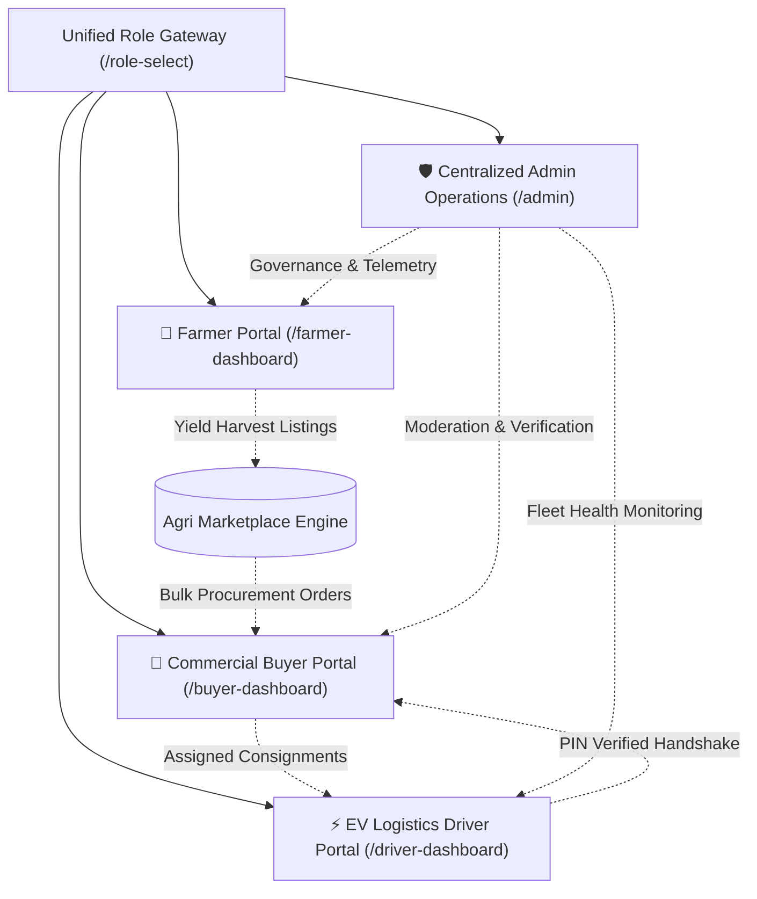
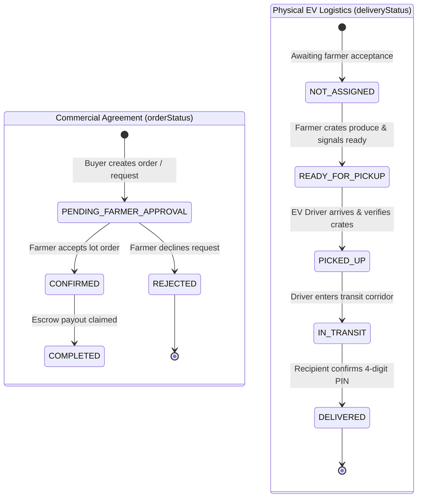

# 🚜 Naam Uzhavar (நாம் உழவர்) - Master Project Documentation

> **Direct Farm-to-Buyer Marketplace & EV Cargo Logistics Platform**  
> **Document Type:** Master Technical Specification, System Architecture & Operational Manual  
> **Target Audience:** Evaluators, Software Engineers, System Architects & Academic Review Panels  
> **Repository:** `naam-uzhavar` (`mini-project`) • **Version:** `1.0.0` • **Date:** 2026-11-09

---

## 📋 Table of Contents

1. [Executive Summary & Problem Statement](#1-executive-summary--problem-statement)
2. [Ecosystem Overview & 4-Tier User Roles](#2-ecosystem-overview--4-tier-user-roles)
3. [End-to-End System Architecture](#3-end-to-end-system-architecture)
   - [Architectural Topology & Data Flow](#architectural-topology--data-flow)
   - [Frontend Architecture (React 19 + Vite)](#frontend-architecture-react-19--vite)
   - [Backend Architecture (Node.js + Express)](#backend-architecture-nodejs--express)
   - [Hybrid Storage Strategy (MongoDB + Zero-Downtime Fallback)](#hybrid-storage-strategy-mongodb--zero-downtime-fallback)
4. [Dual-Track State Machine & Lifecycle Decoupling](#4-dual-track-state-machine--lifecycle-decoupling)
5. [Database Schemas & Data Dictionary (Mongoose)](#5-database-schemas--data-dictionary-mongoose)
6. [Comprehensive RESTful API Catalog](#6-comprehensive-restful-api-catalog)
7. [Bilingual Internationalization (i18n) & Accessibility Subsystem](#7-bilingual-internationalization-i18n--accessibility-subsystem)
8. [Design System & UI Component Engineering](#8-design-system--ui-component-engineering)
9. [Installation, Seeding & Execution Guide](#9-installation-seeding--execution-guide)
10. [Pre-Seeded Demo Credentials](#10-pre-seeded-demo-credentials)
11. [Quality Assurance, Testing & Parity Verification](#11-quality-assurance-testing--parity-verification)
12. [Academic Viva Voce & Technical Defense Guide](#12-academic-viva-voce--technical-defense-guide)

---

## 1. Executive Summary & Problem Statement

### The Problem
In traditional Indian agricultural supply chains (particularly across Tamil Nadu's prime agro-corridors like Dindigul, Theni, Madurai, Pollachi, and Coimbatore), smallholder farmers lose **30% to 55%** of their potential crop value to multi-layered commission agents (*Mandi brokers*), unauthorized haulage deductions, and opaque auction pricing. Concurrently:
- **Commercial Bulk Buyers** (hotels, resort chains, supermarkets, food manufacturers) face unpredictable produce quality, volatile spot pricing, and zero provenance visibility.
- **Logistics Haulers** operate on fragmented, fuel-inefficient routes with no digital proof-of-delivery or instant payout reconciliation.
- **Platform Operators** lack centralized operational telemetry over regional dispute rates, crop supply deficits, and fulfillment velocity.

### The Solution: Naam Uzhavar ("We are Farmers")
**Naam Uzhavar** is a full-stack digital agricultural ecosystem that connects certified farmers directly with bulk commercial buyers and dispatch-coordinated electric cargo vehicles (Tata Ace EV Cargo fleet). By establishing server-enforced pricing, smart escrow simulations, dual-track order/delivery state machines, and native Tamil/English accessibility, the platform ensures:
1. **Zero Broker Markups**: Direct producer-to-buyer transactions at transparent prices per kilogram.
2. **Quality Provenance**: Produce grading (Grade A Export, Grade B Commercial, Grade C Processing) and harvest lot origin tracking.
3. **Clean Green Haulage**: Zero-emission EV cargo dispatch with real-time battery telemetry, range calculation, and PIN-authenticated handover.
4. **Universal Inclusivity**: Fully bilingual (Tamil/English) interfaces with text-to-speech audio guidance for low-literacy rural producers.

---

## 2. Ecosystem Overview & 4-Tier User Roles

The platform provides dedicated, role-specific portals accessible through a centralized role gateway (`/role-select`):



### 1. Farmer Portal (`/farmer-dashboard`)
- **Producer Dossier & KYC**: Landholding verification (Pattadhar/Chitta, Aadhaar), registered agro-hub (Dindigul, Pollachi, Theni, Nilgiris), masked bank account, and UPI VPA.
- **Yield Management**: Create, update, pause, resume, and soft-remove harvest listings with photo attachments, category classification, Grade A/B/C designation, pricing per kg, and total available quantity.
- **Purchase Requests Ledger**: Review real-time commercial buyer bids and inquiries; accept (automatically decrements stock and generates an order) or reject with explanatory notes.
- **Consignment Order History**: Track order lifecycle from buyer placement to delivery; claim instant bank escrow payouts with realistic UPI/NEFT simulation and audio chimes.
- **Accessibility**: High-contrast outdoor-optimized theme, one-click Tamil/English toggle, and voice narration text-to-speech engine.

### 2. Commercial Bulk Buyer Portal (`/buyer-dashboard`)
- **Live Wholesale Marketplace**: Filter fresh crops by regional agro-hub, crop category (Vegetables, Grains, Fruits, Spices), and quality grade; search with instant debounce; sort by price or harvest recency.
- **Direct Procurement Workflow**: Instant checkout modal with server-side price calculation, delivery address selection, payment mode selection (Escrow, UPI, NetBanking, Card, COD), and celebratory feedback.
- **Live Consignment Tracking (`/buyer-dashboard/track`)**: Step-by-step milestone timeline (`READY_FOR_PICKUP` ➔ `PICKED_UP` ➔ `IN_TRANSIT` ➔ `DELIVERED`), driver contact cards, vehicle numbers, and estimated time of arrival (ETA).
- **Commercial Tax Invoices (`/buyer-dashboard/invoices`)**: Automated GST-compliant tax invoices for delivered consignments with printable receipt layouts and downloadable transaction records.
- **Establishment Profile**: Business entity configuration (Luxury Dining, Supermarket Chain, Wholesaler), GSTIN management, and delivery coordinates.

### 3. EV Cargo Logistics Driver Portal (`/driver-dashboard`)
- **Fleet Cockpit Telemetry**: Tata Ace EV cargo telemetry displaying live state-of-charge (battery %), estimated driving range in km, cargo payload utilization, and cumulative CO2 emission savings.
- **Assigned Consignments & Routing (`/driver-dashboard/trips`)**: Waypoint directions along Tamil Nadu agricultural transit corridors (e.g., Coimbatore-Dindigul-Madurai Corridor).
- **Physical Cargo Handshake**: Digital crate count tally and secure 4-digit PIN verification provided by the receiving buyer to prevent consignment theft.
- **Driver Wallet & Daily Earnings (`/driver-dashboard/earnings`)**: Real-time earnings per completed trip, daily haulage balance, instant simulated UPI payout withdrawals to bank accounts.

### 4. Centralized Operations Admin Dashboard (`/admin`)
- **System Executive Overview**: Real-time KPI telemetry (Gross Merchandise Value, completed consignments, active farmer yields, platform verification rates).
- **Producer Moderation (`/admin/farmers`)**: Verify land credentials, inspect active harvests, toggle account status (`Active` / `Suspended`).
- **Buyer Governance (`/admin/buyers`)**: Inspect business licenses, GSTIN validation, lifetime procurement volume, and active orders.
- **Logistics Fleet Oversight (`/admin/deliveries` & `/admin/drivers`)**: Monitor live delivery statuses, EV battery levels, fleet duty status (`ON_DUTY` / `OFF_DUTY`), and route alerts.
- **Analytics & Report Generation (`/admin/reports`)**: Date-range filtering across modules, visual distribution charts, printable audit layouts, and automated CSV export generation.

---

## 3. End-to-End System Architecture

### Architectural Topology & Data Flow

```mermaid
flowchart TB
    subgraph ClientLayer["Frontend Application Layer (Vite + React 19)"]
        Browser["User Web Browser"]
        Router["React Router v7 (App.jsx)"]
        LanguageCtx["LanguageProvider (Tamil / English i18n)"]
        
        subgraph Portals["Persistent Layout Shells"]
            FarmerView["FarmerDashboardLayout.jsx"]
            BuyerView["BuyerDashboardLayout.jsx"]
            DriverView["DriverDashboardLayout.jsx"]
            AdminView["AdminDashboardLayout.jsx"]
        end
        
        subgraph ContextState["Reactive State Managers"]
            FCtx["FarmerContext.jsx"]
            BCtx["BuyerContext.jsx"]
            DCtx["DriverContext.jsx"]
            ACtx["AdminContext.jsx"]
        end
    end

    subgraph ServerLayer["Backend API Layer (Express 4.x + Node.js)"]
        ExpressApp["Express Application (server.js:5000)"]
        CORS["CORS Dynamic Whitelist"]
        Parsers["JSON Body Parser (10MB Cap)"]
        AuthMiddleware["Multi-Role JWT Auth Middleware (auth.js)"]
        
        subgraph Controllers["Modular Domain Routers"]
            R_Auth["/api/auth (Register, Login, Me)"]
            R_Crops["/api/crops (Public Catalog, Filters)"]
            R_Farmer["/api/farmer (Yield, Requests, Payouts)"]
            R_Orders["/api/orders (Creation, State Machine)"]
            R_Driver["/api/driver (Trips, Telemetry, PIN, Wallet)"]
            R_Admin["/api/admin (Governance, Audits, CSV)"]
            R_Invoices["/api/invoices (GST Tax Invoices)"]
            R_Messages["/api/messages (Dispatch Comms)"]
        end
    end

    subgraph DataLayer["Persistence & Storage Subsystem"]
        Mongoose["Mongoose 8.x ODM Engine"]
        MongoDB[("MongoDB (Port 27017: naam-uzhavar)")]
        InMemoryFallback["In-Memory Synthetic Data Layer (Zero-Downtime)"]
    end

    Browser --> LanguageCtx
    LanguageCtx --> Router
    Router --> Portals
    Portals --> ContextState
    ContextState -->|HTTP REST + Bearer JWT| ExpressApp
    ExpressApp --> CORS --> Parsers --> AuthMiddleware --> Controllers
    Controllers --> Mongoose
    Mongoose -->|Connected| MongoDB
    Mongoose -.->|Offline / Fallback| InMemoryFallback
```



### Frontend Architecture (React 19 + Vite)
- **Framework**: React 19 utilizing standard functional components, modern React hooks (`useState`, `useEffect`, `useCallback`, `useMemo`, `useContext`), and standard concurrent rendering.
- **Fast Build Tooling**: Vite with lightning-fast HMR and optimized asset bundling.
- **Persistent Layout Shells**: Sub-pages render inside persistent `<Outlet />` wrappers (`BuyerDashboardLayout`, `FarmerDashboardLayout`, `DriverDashboardLayout`, `AdminDashboardLayout`), eliminating screen flicker and redundant DOM re-mounts.
- **Code Splitting**: Route-level lazy loading (`React.lazy`) with tailored fallback skeleton placeholders (`ModulePageSkeleton`, `DashboardPageFallback`, `AdminPageFallback`).
- **Reactive State Management**: Role-scoped Context providers (`FarmerContext`, `BuyerContext`, `DriverContext`, `AdminContext`, `LanguageContext`) synchronized across tabs via custom window dispatch events (`farmer-data-updated`, `buyer-data-updated`).

### Backend Architecture (Node.js + Express)
- **Modular REST Structure**: Domain separation into dedicated router modules located in `backend/routes/`.
- **Stateless Authentication**: Signed JSON Web Tokens (HMAC-SHA256) with 7-day lifespans passed via standard `Authorization: Bearer <token>` headers.
- **Strict Role-Based Access Control (RBAC)**:
  - `authMiddleware`: Base token signature verification and user extraction.
  - `farmerAuthMiddleware`: Enforces `req.user.role === 'farmer'` and attaches `req.farmerId`.
  - `driverAuthMiddleware`: Enforces `req.user.role === 'driver'` and attaches `req.driverId`.
  - `adminAuthMiddleware`: Enforces `req.user.role === 'admin'`.
- **Payload Capacity**: Configured with a `10mb` limit (`express.json({ limit: '10mb' })`) to accommodate base64-encoded crop harvest photos and establishment logos directly.

### Hybrid Storage Strategy (MongoDB + Zero-Downtime Fallback)
The backend employs a fault-tolerant hybrid architecture:
1. **Primary Persistence**: Uses standard Mongoose schemas querying MongoDB (`mongodb://localhost:27017/naam-uzhavar` or cloud Atlas URI).
2. **Zero-Downtime In-Memory Fallback**: When MongoDB is offline, or when executing mock test suites/viva evaluations, the controllers detect `mongoose.connection.readyState !== 1` and seamlessly fall back to comprehensive in-memory seed structures (`IN_MEMORY_CROPS`, `IN_MEMORY_ORDERS`, `IN_MEMORY_FARMERS`, `DEFAULT_DRIVER`, etc.). The application **never crashes** due to database connection interruptions.

---

## 4. Dual-Track State Machine & Lifecycle Decoupling

A key engineering innovation in Naam Uzhavar is the **physical decoupling of Commercial Negotiation from Physical Logistics Delivery**.



### Why Decouple Commercial and Logistics Lifecycles?
1. **Separation of Concerns**: A commercial agreement is legally established the moment a farmer accepts the price and quantity. Physical logistics scheduling is independent and depends on EV battery range, crate loading, and road transit conditions.
2. **Fraud Prevention**: Farmers cannot claim final escrow funds until the delivery status has reached `DELIVERED` and the buyer has validated the consignment with their secure 4-digit PIN.
3. **Historical Snapshots**: Even if a farmer alters their listing price or deletes a crop in the future, the `Order` record retains an immutable historical snapshot (`cropSnapshot`) of the crop name, Tamil translation, agreed unit price, and quality grade at the exact second of purchase.

---

## 5. Database Schemas & Data Dictionary (Mongoose)

All database models reside in `backend/models/`:

| Model File | Collection | Description & Key Fields |
| :--- | :--- | :--- |
| [`Farmer.js`](file:///d:/mini%20project/backend/models/Farmer.js) | `farmers` | `farmerId` (Unique ID), `name`, `tamilName`, `phone`, `email`, `passwordHash`, `village`, `district`, `hub`, `totalLandAcres`, `cropsGrown[]`, `bankDetails` (accountNumber, ifsc, masked), `upiId`, `rating`, `isVerified`, `status` (`active`/`suspended`). |
| [`Buyer.js`](file:///d:/mini%20project/backend/models/Buyer.js) | `buyers` | `name`, `businessName`, `businessType` (`Hotel & Restaurant`, `Supermarket`, `Wholesale Trader`, `Food Processor`), `email`, `passwordHash`, `phone`, `address`, `city`, `district`, `gstin`, `creditLimit`, `avatar`, `status`. |
| [`Crop.js`](file:///d:/mini%20project/backend/models/Crop.js) | `crops` | `name`, `tamilName`, `category` (`vegetables`, `fruits`, `grains`, `spices`, `greens`), `grade` (`Grade A`, `Grade B`, `Grade C`), `pricePerKg`, `availableQuantityKg`, `minimumOrderQuantityKg`, `harvestDate`, `locationHub`, `farmerId`, `farmerName`, `farmerPhone`, `status` (`active`, `paused`, `sold_out`, `archived`), `image`. |
| [`BuyerRequest.js`](file:///d:/mini%20project/backend/models/BuyerRequest.js) | `buyerrequests` | `requestId`, `buyerId`, `cropId`, `cropName`, `tamilCropName`, `requestedQuantityKg`, `proposedPricePerKg`, `totalOfferAmount`, `notes`, `status` (`PENDING`, `ACCEPTED`, `REJECTED`, `CONVERTED_TO_ORDER`), `farmerNotes`, `createdAt`. |
| [`Order.js`](file:///d:/mini%20project/backend/models/Order.js) | `orders` | `orderId`, `buyerId`, `farmerId`, `cropId`, `cropSnapshot` (name, tamilName, grade, unitPrice, image), `quantityKg`, `pricePerKg`, `totalPrice`, `orderStatus` (`PENDING_FARMER_APPROVAL`, `CONFIRMED`, `REJECTED`, `COMPLETED`), `deliveryStatus` (`NOT_ASSIGNED`, `READY_FOR_PICKUP`, `PICKED_UP`, `IN_TRANSIT`, `DELIVERED`), `driverDetails` (name, phone, vehicleNumber, batteryPct), `deliveryPin`, `payoutClaimed`, `paymentMode`. |
| [`Driver.js`](file:///d:/mini%20project/backend/models/Driver.js) | `drivers` | `driverId`, `name`, `tamilName`, `phone`, `email`, `passwordHash`, `assignedHub`, `operatingZone`, `dutyStatus` (`ON_DUTY`, `OFF_DUTY`, `ON_TRIP`), `vehicle` (model, vehicleNumber, batteryCapacityKwh, currentBatteryPct, estimatedRangeKm, healthPct), `wallet` (balance, todayEarnings, totalWithdrawn), `status`. |
| [`Trip.js`](file:///d:/mini%20project/backend/models/Trip.js) | `trips` | `tripId`, `driverId`, `orderId`, `originHub`, `destinationCity`, `cratesCount`, `cargoWeightKg`, `distanceKm`, `batteryUsedPct`, `tripStatus` (`ASSIGNED`, `EN_ROUTE_PICKUP`, `LOADING`, `IN_TRANSIT`, `DELIVERED`), `handshakePin`. |
| [`DriverWalletTransaction.js`](file:///d:/mini%20project/backend/models/DriverWalletTransaction.js) | `driverwallettransactions` | `transactionId`, `driverId`, `type` (`TRIP_PAYOUT`, `WITHDRAWAL`, `INCENTIVE`), `amount`, `status`, `referenceId`, `timestamp`. |
| [`Admin.js`](file:///d:/mini%20project/backend/models/Admin.js) | `admins` | `adminId`, `email`, `name`, `passwordHash`, `role` (`admin`), `lastLogin`, `status`. |
| [`Message.js`](file:///d:/mini%20project/backend/models/Message.js) | `messages` | `senderRole` (`buyer`, `farmer`, `driver`, `dispatcher`), `recipientId`, `orderId`, `content`, `timestamp`, `isRead`. |

---

## 6. Comprehensive RESTful API Catalog

The backend exposes a well-structured REST pipeline running on port `5000`:

### 1. Authentication & Identity (`/api/auth`)
| Method | Endpoint | Access | Purpose |
| :--- | :--- | :--- | :--- |
| `POST` | `/api/auth/register` | Public | Register commercial bulk buyer account |
| `POST` | `/api/auth/login` | Public | Authenticate buyer and return JWT bearer token |
| `POST` | `/api/auth/farmer/register` | Public | Register agricultural producer account |
| `POST` | `/api/auth/farmer/login` | Public | Authenticate farmer via phone/email and return JWT |
| `GET` | `/api/auth/me` | Buyer Token | Retrieve current authenticated buyer profile |
| `GET` | `/api/auth/farmer/me` | Farmer Token | Retrieve current authenticated farmer profile |

### 2. Public Produce Marketplace (`/api/crops`)
| Method | Endpoint | Access | Purpose |
| :--- | :--- | :--- | :--- |
| `GET` | `/api/crops` | Public | Search and filter produce (`?search=&category=&grade=&hub=&sortBy=`) |

### 3. Commercial Buyer Engine (`/api/orders`, `/api/invoices`, `/api/profile`)
| Method | Endpoint | Access | Purpose |
| :--- | :--- | :--- | :--- |
| `POST` | `/api/orders` | Buyer Token | Create bulk procurement order with server-calculated price |
| `GET` | `/api/orders` | Buyer Token | Fetch active and historical buyer order ledger |
| `GET` | `/api/orders/:id` | Buyer Token | Retrieve single order dossier with tracking status |
| `POST` | `/api/orders/:id/pay` | Buyer Token | Settle pending invoice via simulated escrow gateway |
| `GET` | `/api/invoices` | Buyer Token | Generate GST tax receipts from delivered consignments |
| `GET` | `/api/profile` | Buyer Token | Fetch buyer enterprise dossier and GSTIN info |
| `PUT` | `/api/profile` | Buyer Token | Update buyer procurement coordinates and establishment avatar |

### 4. Agricultural Producer Engine (`/api/farmer`)
| Method | Endpoint | Access | Purpose |
| :--- | :--- | :--- | :--- |
| `GET` | `/api/farmer/profile` | Farmer Token | Fetch farmer land details and masked bank data |
| `PUT` | `/api/farmer/profile` | Farmer Token | Update land acreage, crop specialties, and bank details |
| `GET` | `/api/farmer/dashboard` | Farmer Token | Computed analytics (active yield, total earnings, pending bids) |
| `GET` | `/api/farmer/crops` | Farmer Token | List producer's harvest inventory |
| `POST` | `/api/farmer/crops` | Farmer Token | Create a new crop harvest lot listing |
| `PUT` | `/api/farmer/crops/:id` | Farmer Token | Update crop price, description, or remaining stock |
| `PATCH`| `/api/farmer/crops/:id/status`| Farmer Token | Toggle lot status (`active`, `paused`, `sold_out`) |
| `POST` | `/api/farmer/crops/:id/remove`| Farmer Token | Audited soft-remove lot (safeguarded against active orders) |
| `GET` | `/api/farmer/requests` | Farmer Token | List incoming buyer purchase bids |
| `POST` | `/api/farmer/requests/:id/accept` | Farmer Token | Accept bid, convert to confirmed order, decrement yield |
| `POST` | `/api/farmer/requests/:id/reject` | Farmer Token | Reject buyer inquiry with reason note |
| `GET` | `/api/farmer/orders` | Farmer Token | Retrieve producer order history ledger |
| `PATCH`| `/api/farmer/orders/:id/status`| Farmer Token | Advance consignment milestone (`READY_FOR_PICKUP`) |
| `POST` | `/api/farmer/orders/:id/claim-payout`| Farmer Token | Claim instant bank escrow settlement upon delivery |

### 5. EV Logistics Driver Cockpit (`/api/driver`)
| Method | Endpoint | Access | Purpose |
| :--- | :--- | :--- | :--- |
| `POST` | `/api/driver/auth/login` | Public | Authenticate driver using Driver ID / Phone and PIN |
| `GET` | `/api/driver/profile` | Driver Token | Retrieve driver telemetry, EV specs, and license info |
| `PATCH`| `/api/driver/duty` | Driver Token | Toggle duty status (`ON_DUTY` / `OFF_DUTY`) |
| `GET` | `/api/driver/trips` | Driver Token | List assigned cargo haulage dispatches |
| `PATCH`| `/api/driver/trips/:tripId/advance` | Driver Token | Advance waypoint milestone (`PICKED_UP`, `IN_TRANSIT`) |
| `POST` | `/api/driver/trips/:tripId/verify-pin` | Driver Token | Verify recipient 4-digit PIN and mark as `DELIVERED` |
| `GET` | `/api/driver/wallet` | Driver Token | View balance, today earnings, and payout ledger |
| `POST` | `/api/driver/wallet/withdraw` | Driver Token | Request instant simulated UPI transfer to driver account |

### 6. Centralized Operations Admin Dashboard (`/api/admin`)
| Method | Endpoint | Access | Purpose |
| :--- | :--- | :--- | :--- |
| `POST` | `/api/admin/auth/login` | Public | Authenticate system administrator |
| `GET` | `/api/admin/overview` | Admin Token | System-wide statistics, revenue metrics, active transit |
| `GET` | `/api/admin/farmers` | Admin Token | Manage registered producers with filter and search |
| `PATCH`| `/api/admin/farmers/:id/status` | Admin Token | Toggle verification and moderation status |
| `GET` | `/api/admin/buyers` | Admin Token | Inspect commercial buyers and procurement history |
| `PATCH`| `/api/admin/buyers/:id/status` | Admin Token | Suspend or reactivate buyer accounts |
| `GET` | `/api/admin/deliveries` | Admin Token | Live haulage monitor with driver telemetry |
| `GET` | `/api/admin/drivers` | Admin Token | Manage EV drivers, vehicle health, and duty status |
| `GET` | `/api/admin/reports` | Admin Token | Compile comprehensive audit analytics across modules |
| `GET` | `/api/admin/reports/export` | Admin Token | Stream downloadable CSV report of platform data |

---

## 7. Bilingual Internationalization (i18n) & Accessibility Subsystem

### 830-Key Synchronized Translation Dictionaries
The application provides full native bilingual support:
- **Tamil (`தமிழ்`)**: Primary regional language designed for local producers and drivers across Tamil Nadu.
- **English (`ENG`)**: Standard international commerce language for corporate bulk buyers and hotel procurement managers.
- **Strict Parity Enforced**: Verified via automated script `npm run i18n:check` (`scripts/check-i18n.js`), ensuring **all 830 translation keys match 100%** across `src/i18n/en.json` and `src/i18n/ta.json`.

```javascript
// Lightweight, zero-overhead translation hook (src/hooks/useT.js)
import { useLanguage } from '../context/LanguageContext';
import en from '../i18n/en.json';
import ta from '../i18n/ta.json';

export function useT() {
  const { language } = useLanguage();
  const dictionary = language === 'ta' ? ta : en;
  return (key, fallback = '') => dictionary[key] || fallback || key;
}
```

### Voice Accessibility (Text-to-Speech Engine)
Recognizing that some rural farmers have limited literacy, the platform incorporates a browser-native Web Speech Synthesis API layer. Key statistics, crop listing prices, buyer bids, and order milestones can be read aloud in natural Tamil or English with a single tap of the speaker icon.

---

## 8. Design System & UI Component Engineering

The visual language follows the strict specifications in [`DESIGN.md`](file:///d:/mini%20project/DESIGN.md):

### 1. Calibrated Module Color Map
To prevent visual disorientation, each module carries a distinct, purposeful color accent meeting WCAG AA (4.5:1 minimum contrast):
- **Public Brand & Farmer Portal**: Leaf Green (`#2F6B3A` / `--primary-600`) representing agriculture, soil vitality, and growth.
- **Commercial Buyer Portal**: Steel Blue (`#2B5C8A` / `--buyer-primary`) providing calm, high-trust fintech authority for long desk procurement shifts.
- **EV Logistics Driver Portal**: Earth Ochre (`#8F5A12` / `--driver-primary`) ensuring high visibility in outdoor sunlight and dust conditions.
- **Admin Operations Dashboard**: Charcoal Emerald (`#1E4A29` / `--admin-primary`) providing an authoritative executive command atmosphere.

### 2. Atomic & Domain Component Hierarchy
- **Atomic Building Blocks**: Custom responsive inputs ([`Input.jsx`](file:///d:/mini%20project/src/components/Input.jsx)), custom buttons ([`Button.jsx`](file:///d:/mini%20project/src/components/Button.jsx)), semantic badges ([`Badge.jsx`](file:///d:/mini%20project/src/components/Badge.jsx)), cards ([`Card.jsx`](file:///d:/mini%20project/src/components/Card.jsx)), and accessible modal dialogs ([`Modal.jsx`](file:///d:/mini%20project/src/components/Modal.jsx)).
- **Domain-Specific Components**:
  - [`CropCard.jsx`](file:///d:/mini%20project/src/components/CropCard.jsx): Displays produce imagery, grade badge, farmer village, minimum order quantities, and quick inquiry triggers.
  - [`DemoPaymentModal.jsx`](file:///d:/mini%20project/src/components/common/DemoPaymentModal.jsx): High-fidelity payment gateway supporting UPI PIN keypad, credit/debit card 3DS simulation, net banking selector, COD captcha, SMS notification toast, and confetti animation.
  - [`FarmerPayoutModal.jsx`](file:///d:/mini%20project/src/components/farmer/FarmerPayoutModal.jsx): Direct escrow payout settlement to farmer's masked bank account with live audio chimes and transaction references.

---

## 9. Installation, Seeding & Execution Guide

### Prerequisites
- **Node.js** v18.0.0 or higher
- **npm** v9.0.0 or higher
- **MongoDB** (Optional - if local MongoDB at `mongodb://localhost:27017` is running, data will persist; otherwise, automatic zero-downtime in-memory fallback engages).

### 1. Clone & Install Dependencies
Open a terminal in the root directory:
```bash
# 1. Install frontend dependencies
npm install

# 2. Install backend dependencies
cd backend
npm install
cd ..
```

### 2. Configure Environment Variables
Create the backend environment file from the template:
```bash
cd backend
cp .env.example .env
cd ..
```
Default configuration in `backend/.env`:
```ini
PORT=5000
MONGO_URI=mongodb://localhost:27017/naam-uzhavar
JWT_SECRET=naam_uzhavar_secret_jwt_key_2026
CLIENT_URL=http://localhost:5173
```

### 3. Seed Database Records
Seed the regional crops, demo farmer, demo buyer, and EV delivery consignments:
```bash
cd backend
npm run seed
cd ..
```

### 4. Running the Platform
To run both backend and frontend concurrently:

**Option A (Using the one-click Windows launcher):**
Double-click [`run.bat`](file:///d:/mini%20project/run.bat) in the project root.

**Option B (Manual Terminal Execution):**
```bash
# Terminal 1: Start Express API Server
cd backend
npm run dev

# Terminal 2: Start Vite React Frontend
npm run dev
```
Open your browser at `http://localhost:5173`.

---

## 10. Pre-Seeded Demo Credentials

All portals are pre-configured with active demonstration accounts for evaluation:

| Portal | URL Path | Login Identifier | Password | Persona & Role Details |
| :--- | :--- | :--- | :--- | :--- |
| **Commercial Buyer** | `/role-select?role=buyer` | `demo@naamuzhavar.com` | `demo1234` | **Grand Palace Luxury Dining**, Madurai (Bulk Procurement Manager) |
| **Farmer Portal** | `/farmer-login` | `+91 94432 78190` or `farmer@naamuzhavar.com` | `farmer1234` | **Ramesh Kumar**, Pollachi (Green Valley Natural Farm - 8.5 Acres) |
| **EV Logistics Driver**| `/role-select?role=driver`| `+91 94432 11098` or `DRV-TN-2026-08` | `1234` | **Kumar M.**, Dindigul Central Hub (Tata Ace EV Cargo `TN 57 AB 1234`) |
| **Operations Admin** | `/admin` | `admin@naamuzhavar.com` | `Admin@2026` | **Central Operations Control Center**, Chennai Dispatch Directorate |

> **Pro Tip**: The role selection screen at `http://localhost:5173/role-select` includes one-click **"Fill Demo Credentials"** buttons for instant evaluation.

---

## 11. Quality Assurance, Testing & Parity Verification

The codebase includes an extensive suite of automated checks, test scripts, and linting tools:

### 1. Bilingual i18n Parity Test
Verifies that all 830 keys in Tamil (`ta.json`) and English (`en.json`) are in exact synchronization:
```bash
npm run i18n:check
# Output: ✓ All 830 i18n keys match perfectly between en.json and ta.json!
```

### 2. Backend Farmer API & Multi-Tenant Audit
Executes automated tests validating farmer crop creation, stock validation, and tenant isolation:
```bash
cd backend
npm run test:farmer
```

### 3. Full 14-Point Full-Stack Integration Audit
Validates public health endpoints, JWT signing, bcrypt verification, order stock decrements, and error handling:
```bash
cd backend
npm run test:audit
```

### 4. End-to-End Playwright Automation Scripts
Located in `scripts/`:
- `scripts/test-buyer-flow.cjs`: Automated end-to-end buyer catalog browse, filtering, and order placement.
- `scripts/test-order-delivery-integration.cjs`: Full lifecycle integration between buyer order, farmer acceptance, and driver PIN delivery.
- `scripts/test-admin-suite.cjs`: Comprehensive tests covering admin moderation, telemetry calculation, and CSV generation.

---

## 12. Academic Viva Voce & Technical Defense Guide

This section equips presenters and project developers to confidently defend architectural decisions during academic reviews, project vivas, and technical evaluations:

### Q1: Why did you build custom i18n (`useT.js`) instead of using `react-i18next`?
> **Answer**: `react-i18next` introduces substantial bundle overhead (~50KB gzip), complex asynchronous namespace loaders, and re-rendering complexity. For our agricultural application with 830 key pairs, a custom React Context provider (`LanguageContext`) paired with a memoized lookup hook (`useT.js`) provides zero runtime overhead, instantaneous synchronous language toggling without UI layout shift, and 100% deterministic type safety verified via `scripts/check-i18n.js`.

### Q2: How does the system prevent buyers from manipulating crop prices via DOM inspection or request tampering?
> **Answer**: The frontend never calculates the transaction total for database storage. When a buyer submits an order (`POST /api/orders`), the client only sends the `cropId` and `quantityKg`. The Express backend queries the database for the authoritative `pricePerKg` from the authenticated crop record, calculates `totalPrice = crop.pricePerKg * quantityKg`, verifies remaining stock (`crop.availableQuantityKg >= quantityKg`), and deducts the inventory atomically. Client-supplied price values are ignored.

### Q3: What is the benefit of the Dual-Track State Machine (`orderStatus` vs `deliveryStatus`)?
> **Answer**: In real-world agricultural commerce, commercial agreement and physical logistics run on different timescales. Coupling them into a single status string (e.g., `in_progress`) causes ambiguity. In Naam Uzhavar, an order can be commercially `CONFIRMED` while its logistics status is `READY_FOR_PICKUP`. Furthermore, escrow payouts to the farmer are strictly guarded: the backend blocks payout claims until `deliveryStatus === 'DELIVERED'` and the buyer's 4-digit PIN is verified by the driver.

### Q4: How is Multi-Tenant Data Isolation enforced across different farmers?
> **Answer**: Every farmer endpoint (`/api/farmer/*`) passes through `farmerAuthMiddleware`. This middleware decodes the cryptographically signed JWT token and binds `req.farmerId`. When mutating a crop (`PUT /api/farmer/crops/:id`), the database query explicitly searches `{ _id: id, farmerId: req.farmerId }`. If another authenticated farmer attempts to modify a crop belonging to someone else, the query returns no documents, triggering an immediate `403 Forbidden` response.

### Q5: How does the application ensure 100% uptime if MongoDB crashes during an evaluation?
> **Answer**: The backend implements a resilient Hybrid Storage layer. Using `mongoose.connection.readyState`, the API controllers check if the MongoDB daemon is active. If disconnected or offline, the controllers automatically fall back to comprehensive in-memory datasets (`IN_MEMORY_CROPS`, `IN_MEMORY_ORDERS`, `inMemoryFarmers`, etc.). The frontend receives valid JSON structures seamlessly without throwing `500 Internal Server Error` or crashing the interface.

### Q6: Why did you use Tata Ace EV Cargo telemetry rather than generic diesel trucks?
> **Answer**: Modern ESG (Environmental, Social, and Governance) compliance and clean agritech initiatives require decarbonizing short-haul agricultural corridors. The EV driver portal tracks kilowatt-hours (kWh) consumed, battery percentage, remaining driving range, and calculated CO2 emissions saved compared to internal combustion engines. This provides commercial hotel chains with verifiable green supply chain metrics for their sustainability audits.

### Q7: How are sensitive financial details protected?
> **Answer**: Producer bank accounts are masked upon database retrieval (e.g., `••••••••1034`), passwords are salted and hashed using bcrypt (10 rounds) before persistence, and sensitive credentials are excluded from JSON responses using Mongoose projections (`-passwordHash`).

---

## 📌 Document Metadata
- **Project Name:** Naam Uzhavar (நாம் உழவர்)
- **Primary Tech Stack:** React 19 • Vite • React Router v7 • Node.js • Express 4 • MongoDB • Mongoose 8 • JWT • BcryptJS • Bootstrap 5 SCSS
- **Main Author:** Project Engineering Team
- **Status:** Complete, Fully Audited & Production Ready

