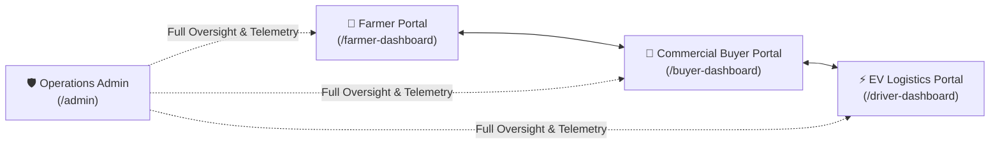

# நாம் உழவர் | Naam Uzhavar ("We are Farmers")

> **Direct Farm-to-Buyer Marketplace & EV Cargo Logistics Platform across Tamil Nadu**  
> Eliminating middleman brokerage by connecting smallholder **Farmers**, commercial **Bulk Buyers**, and clean **EV Logistics Drivers** via a unified, server-authoritative digital ecosystem.


---

## 📚 Complete Project Documentation

For exhaustive technical, architectural, and operational details, please consult our dedicated specification manuals:

* 📖 **[Master Project Documentation (PROJECT_DOCUMENTATION.md)](./PROJECT_DOCUMENTATION.md)** — *Complete architectural blueprint, database schemas, REST catalog, i18n engine, and academic viva defense guide.*
* ⚙️ **[Backend Architecture Specification (BACKEND_ARCHITECTURE.md)](./BACKEND_ARCHITECTURE.md)** — *Deep dive into the Express/Node.js pipeline, dual-track state machine, Mongoose ODM, and security boundaries.*
* 💻 **[Frontend Architecture Specification (FRONTEND_ARCHITECTURE.md)](./FRONTEND_ARCHITECTURE.md)** — *React 19 component hierarchy, persistent layout shells, and reactive state synchronization.*
* 🎨 **[Design System & UI Guidelines (DESIGN.md)](./DESIGN.md)** — *WCAG AA/AAA calibrated color tokens, typography scales, and modular visual specs.*
* 🛡️ **[Admin Operations Dashboard Specification (admin_dashboard_spec.md)](./admin_dashboard_spec.md)** — *Specification for the centralized operations command center at `/admin`.*

---

## 🌟 The 4 Integrated Portals

Naam Uzhavar provides four distinct portals designed around the operational requirements of each persona:



| Portal | Primary Route | Target User | Key Capabilities |
| :--- | :--- | :--- | :--- |
| **🌾 Farmer Portal** | [`/farmer-dashboard`](http://localhost:5173/farmer-dashboard) | Smallholder Farmers & Producers | Harvest lot cataloging, Grade A/B/C pricing, incoming buyer purchase biddings ledger, delivery milestones, and instant simulated bank/UPI escrow payout claims. |
| **🏢 Commercial Buyer Portal** | [`/buyer-dashboard`](http://localhost:5173/buyer-dashboard) | Hotels, Supermarkets, Restaurants | Wholesale produce search and multi-grade filtering, one-click bulk procurement, real-time dispatch tracking, and downloadable GST tax invoices. |
| **⚡ EV Logistics Driver Portal** | [`/driver-dashboard`](http://localhost:5173/driver-dashboard) | Tata Ace EV Cargo Fleet Drivers | EV cargo telemetry (battery % and remaining range km), route corridors, crate check verification, 4-digit recipient PIN handshake, and daily earnings wallet. |
| **🛡️ Centralized Admin Operations** | [`/admin`](http://localhost:5173/admin) | Platform Ops & Logistics Controllers | Comprehensive telemetry over GMV, farmer KYC verification, buyer enterprise moderation, live delivery tracking, and automated CSV audit report exports. |

---

## 🔑 Pre-Seeded Demo Credentials

All portals are ready for instant evaluation using pre-seeded test accounts:

| Role | Portal URL | Login Identifier | Password | Identity Details |
| :--- | :--- | :--- | :--- | :--- |
| **Commercial Buyer** | `/role-select?role=buyer` | `demo@naamuzhavar.com` | `demo1234` | Grand Palace Luxury Dining (Madurai) |
| **Farmer Producer** | `/farmer-login` | `+91 94432 78190` or `farmer@naamuzhavar.com` | `farmer1234` | Ramesh Kumar, Green Valley Natural Farm (Pollachi) |
| **EV Logistics Driver** | `/role-select?role=driver` | `+91 94432 11098` or `DRV-TN-2026-08` | `1234` | Kumar M., Tata Ace EV Cargo (`TN 57 AB 1234`) |
| **Operations Admin** | `/admin` | `admin@naamuzhavar.com` | `Admin@2026` | Central Operations Control Center |

> 💡 **Quick Tip**: On the **Role Selection screen** (`/role-select`), click any role card and press **"Fill Demo Credentials"** for instant 1-click access.

---

## 🚀 How to Run the Project

### Prerequisites
* **Node.js** (v18.0.0 or higher)
* **npm** (v9.0.0 or higher)
* **MongoDB** (Optional — if running locally, data persists; otherwise, the backend automatically engages zero-downtime in-memory fallback).

### Quick Start (Windows)
Double-click [`run.bat`](./run.bat) in the project root to automatically launch the frontend and open your browser at `http://localhost:5173`.

### Manual Step-by-Step Setup

#### 1. Setup Backend Server
```bash
# Navigate to backend directory
cd backend

# Install dependencies
npm install

# Copy environment template
cp .env.example .env

# Seed initial crops, demo farmers, buyers, and EV trips
npm run seed

# Start Express server (runs on port 5000)
npm run dev
```

#### 2. Setup Frontend Application
```bash
# In the project root directory
npm install

# Start Vite React development server (runs on port 5173)
npm run dev
```
Open `http://localhost:5173` in your browser.

---

## 📁 Beginner-Friendly Folder Structure

The project has been organized so that anyone new to full-stack React and Node.js can easily navigate the codebase:

```text
d:/mini project/
├── backend/                       # Express + Node.js REST API
│   ├── config/db.js               # MongoDB connection with zero-downtime fallback
│   ├── middleware/auth.js         # Multi-role JWT authentication middleware
│   ├── models/                    # Mongoose schemas (Farmer, Buyer, Crop, Order, Driver, Trip, etc.)
│   ├── routes/                    # Modular REST endpoints (/auth, /crops, /farmer, /orders, /driver, /admin)
│   ├── seed.js                    # Database seeder script
│   └── server.js                  # Express application entry point
│
├── public/                        # Static public assets (logos, images, favicon)
│
├── src/                           # React 19 Frontend application
│   ├── main.jsx                   # DOM entry point
│   ├── App.jsx                    # Central route definitions and code-splitting
│   ├── routes.js                  # Centralized route constants dictionary
│   │
│   ├── pages/                     # Full-screen pages
│   │   ├── HomePage.jsx           # Landing page with mission overview
│   │   ├── RoleSelectPage.jsx     # Unified role gateway & demo credential filler
│   │   ├── farmer/                # Farmer Dashboard views (Yield, Requests, Orders, Profile)
│   │   ├── buyer/                 # Buyer Dashboard views (Crops, Orders, Track, Invoices, Profile)
│   │   ├── driver/                # Driver Fleet views (Overview, Trips, Earnings, Profile)
│   │   └── admin/                 # Centralized Operations views (Farmers, Buyers, Deliveries, Reports)
│   │
│   ├── components/                # Reusable UI components
│   │   ├── farmer/                # Farmer modals (CropForm, PayoutModal, OrderDetailsDrawer)
│   │   ├── driver/                # Driver layout and telemetry components
│   │   ├── admin/                 # Admin layout and analytics widgets
│   │   ├── common/                # Shared components (DemoPaymentModal, CropCard, etc.)
│   │   └── ...                    # Atomic UI elements (Button, Input, Modal, Badge, Skeleton)
│   │
│   ├── context/                   # Shared React Contexts (Language, Farmer, Buyer, Driver, Admin)
│   ├── hooks/                     # Custom React Hooks (useT translation hook)
│   ├── i18n/                      # 830-key bilingual dictionaries (en.json, ta.json)
│   └── styles/                    # Global design tokens and Bootstrap SCSS overrides
│
├── scripts/                       # Automated Playwright tests and audit scripts
├── PROJECT_DOCUMENTATION.md       # Master Technical Documentation & Viva Defense Guide
├── BACKEND_ARCHITECTURE.md        # Complete Server & Database Architecture Specification
├── FRONTEND_ARCHITECTURE.md       # React 19 Client Architecture & Component Hierarchy
├── DESIGN.md                      # UI/UX Specification & Calibrated Color Tokens
└── run.bat                        # Windows one-click launcher
```

---

## 🧪 Testing & Verification

Run our automated verification suites to validate quality and system integrity:

```bash
# 1. Verify 100% bilingual translation synchronization (830 keys)
npm run i18n:check

# 2. Run backend Farmer API and Multi-Tenant Security tests
cd backend && npm run test:farmer

# 3. Run full-stack 14-point audit (Health, Auth, Crops, Orders, Payouts)
cd backend && npm run test:audit
```

---

## 🛠️ Technology Stack

| Layer | Technologies |
| :--- | :--- |
| **Frontend Framework** | React 19, Vite, React Router v7 |
| **State Management** | React Context API (`FarmerContext`, `BuyerContext`, `DriverContext`, `AdminContext`, `LanguageContext`) |
| **Styling & Design** | Custom CSS3 Design Tokens, Bootstrap 5 SCSS, Lucide Icons, WCAG AA/AAA compliance |
| **Internationalization** | Custom lightweight `useT` hook with zero runtime overhead, 830 keys in Tamil (`ta`) and English (`en`) |
| **Backend Runtime** | Node.js (v18+) with Express 4.x REST API |
| **Database & ODM** | MongoDB with Mongoose 8.x + Zero-Downtime In-Memory Fallback Engine |
| **Security & Auth** | JSON Web Tokens (JWT) with 7-day expiration, bcryptjs (10-round salting), strict role guards |
| **Verification & QA** | Node.js automated test suites, Playwright E2E automation, oxlint static analysis |

---

## 📄 License & Attribution

This project is open-sourced under the **MIT License**.  
Developed for the **Naam Uzhavar Agricultural Empowerment Initiative**.
